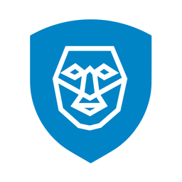

  

<h1 align="center">FaceTouch Pro</h1>

<strong>Khuôn mặt &amp; vân tay · Kiểm soát ra vào</strong>

Python · YOLO · ArcFace · ESP32 · MQTT/TLS

FaceTouch Pro là hệ thống quản lý ra vào kết hợp nhận diện khuôn mặt, cảm biến vân tay và điều khiển khóa cửa. Quản trị viên đăng ký nhân viên, quản lý khuôn mặt/vân tay và xem nhật ký trên laptop. Người sử dụng xác thực tại camera hoặc cảm biến; màn hình TFT hiển thị ảnh và kết quả.

**Laptop xử lý AI, ESP32 điều khiển phần cứng.** Camera và TFT không chạy mô hình nhận diện. Camera dùng mạng LAN; MQTT Cloud và Telegram cần Internet. Vân tay và nút mở bên trong được xử lý cục bộ trên bo cửa khi bo đang ở chế độ vận hành.

> Repository không bao gồm trọng số AI, dữ liệu nhân viên hoặc mật khẩu. Clone mã nguồn chưa đủ để nhận diện: cần chuẩn bị model và cấu hình theo hướng dẫn dưới đây.

**Đã cài sẵn?** Cấp nguồn các bo, kết nối laptop cùng Wi-Fi với camera/màn hình, rồi nhấp biểu tượng **FaceTouch Pro** trên Desktop. Hoặc chạy:

~~~powershell
.\venv\Scripts\python.exe facetouch_pro.py wifi
~~~

**Lần đầu đọc dự án?** Bắt đầu từ kiến trúc, sau đó đến cài đặt/model/cấu hình. Có thể thử webcam trước khi lắp đầy đủ phần cứng.

## Mục lục

- [1. Chức năng](#1-chức-năng)
- [2. Kiến trúc và nguyên lý](#2-kiến-trúc-và-nguyên-lý)
- [3. Phần cứng và môi trường](#3-phần-cứng-và-môi-trường)
- [4. Cài đặt trên laptop](#4-cài-đặt-trên-laptop)
- [5. Cấu hình](#5-cấu-hình)
- [6. Chạy chương trình](#6-chạy-chương-trình)
- [7. Sử dụng hằng ngày](#7-sử-dụng-hằng-ngày)
- [8. Đổi Wi-Fi](#8-đổi-wi-fi)
- [9. Build và nạp firmware](#9-build-và-nạp-firmware)
- [10. Mạng và API](#10-mạng-và-api)
- [11. Cấu trúc mã nguồn](#11-cấu-trúc-mã-nguồn)
- [12. Dữ liệu và sao lưu](#12-dữ-liệu-và-sao-lưu)
- [13. Kiểm thử và công cụ](#13-kiểm-thử-và-công-cụ)
- [14. Xử lý lỗi](#14-xử-lý-lỗi)
- [15. Giới hạn triển khai](#15-giới-hạn-triển-khai)

## 1. Chức năng

### Phần mềm laptop

- Camera từ ESP32 Wi-Fi, webcam hoặc USB-OTG với firmware riêng.
- Phát hiện mặt bằng YOLO, kiểm tra chất lượng/tư thế bằng MediaPipe, nhận diện bằng ArcFace.
- Đăng ký, sửa, tìm kiếm, bật/tắt nhận diện và xóa hồ sơ khuôn mặt.
- Đăng ký, đồng bộ, liên kết mã vân tay với nhân viên và xóa mẫu.
- Dashboard, giám sát camera/bo cửa, nhật ký xác thực và sự kiện.
- Yêu cầu mở khóa có thời hạn qua MQTT/TLS, theo dõi ACK và chống gửi lặp.
- Giao diện quản trị trên laptop và chế độ kiosk.
- Launcher Desktop tự tìm camera, hiện tiến trình khởi động, cho tìm lại và xem log.
- Cảnh báo Telegram tùy chọn theo chính sách xác thực thất bại.

### Phần nhúng

- **Camera ESP32-S3 + OV3660:** chụp JPEG, phát MJPEG, trang chẩn đoán.
- **Bo cửa ESP32-S3:** AS608, relay, nút, OLED, MQTT và Telegram.
- **TFT ESP32-035:** tải ảnh/trạng thái, tự tìm máy chủ khi IP laptop thay đổi.
- **Cấu hình Wi-Fi:** RESET hai lần để chọn mạng và lưu NVS; không cần nạp lại firmware mỗi lần đổi mạng.

## 2. Kiến trúc và nguyên lý

~~~mermaid
flowchart LR
    Camera["ESP32-S3 + OV3660"] -->|"MJPEG qua Wi-Fi"| Laptop["Laptop: AI và quản trị"]
    Laptop -->|"JPEG và trạng thái qua LAN"| TFT["Màn hình ESP32-035"]
    Laptop <-->|"Lệnh, ACK, sự kiện"| MQTT["MQTT Broker qua TLS"]
    MQTT <--> Door["ESP32-S3 bo cửa"]
    Finger["AS608: vân tay"] --> Door
    Button["Nút mở bên trong"] --> Door
    Door --> Lock["Relay và khóa"]
    Door --> OLED["OLED"]
~~~

Laptop, camera và TFT cần liên lạc được trong cùng LAN. Bo cửa giao tiếp qua broker MQTT nên có thể ở mạng khác nếu cả hai truy cập được broker; dùng chung mạng giúp vận hành thuận tiện hơn.

### Nhận diện khuôn mặt

1. Laptop nhận frame mới nhất để hạn chế độ trễ hàng đợi.
2. YOLO phát hiện mặt; kiểm tra kích thước, vị trí, độ sáng, tư thế và độ ổn định.
3. Mặt hợp lệ được cắt/căn chỉnh; ArcFace tạo vector 512 chiều.
4. Vector từ các frame liên tiếp được chuẩn hóa và gộp để giảm nhiễu.
5. So với centroid của từng hồ sơ đang bật nhận diện; xét khoảng cách Top 1 và độ tách biệt Top 1/Top 2.
6. Chỉ kết quả đạt điều kiện khớp được xử lý thành công. Mơ hồ/người lạ không cho phép mở khóa; hồ sơ benchmark LFW không tham gia xác thực thực tế.

Quy tắc ở [recognition_policy.py](recognition_policy.py); ngưỡng và timing ở [config.py](config.py). Đánh giá cả nhận nhầm và từ chối nhầm trên dữ liệu đại diện, thay vì hạ ngưỡng theo vài mẫu thử.

### Vân tay và mở khóa

AS608 so khớp tại bo cửa. Server quản lý liên kết mã vân tay với nhân viên; template vân tay giữ trong cảm biến, không truyền lên laptop qua MQTT.

MQTT callback kiểm tra lệnh và đưa vào queue; task khóa mới thực hiện relay. Lệnh có mã riêng, hạn dùng và ACK bắt đầu/hoàn tất/thất bại. Cooldown và chốt theo danh tính/vị trí mặt hạn chế mở lặp; không tự gửi lại OPEN khi mất ACK.

**Xác thực thành công không đồng nghĩa cánh cửa đã mở vật lý.** Chưa có cảm biến vị trí cửa. Chi tiết: [Luồng xác thực và điều khiển khóa](docs/door_flow.md).

## 3. Phần cứng và môi trường

Có thể bắt đầu thử AI/giao diện bằng laptop và webcam. Hệ thống đầy đủ dùng:

- Windows 10/11; **Python 3.11** được khuyến nghị.
- ESP32-S3 WROOM CAM + **OV3660**, có PSRAM phù hợp.
- Bo cửa **ESP32-S3-WROOM-1-N16R8**, AS608, OLED SSD1306, relay/khóa, nút mở bên trong; còi/đèn theo sơ đồ.
- **ESP32-035**, TFT 3,5 inch; ST7796 mặc định hoặc ILI9488 tùy bo.
- Wi-Fi **2.4 GHz** cho ESP, cho phép các thiết bị trong LAN giao tiếp.
- Internet cho MQTT Cloud, Telegram hoặc tải dependency/model lần đầu.
- PlatformIO và cáp USB dữ liệu để build/nạp firmware.

GPU NVIDIA/CUDA là tùy chọn, có lựa chọn CPU nếu CUDA không khả dụng. Hiệu năng tùy máy, nguồn, model và Wi-Fi; camera/TFT hiện hướng đến khoảng **5 FPS**, không cam kết trên mọi cấu hình.

ESP có thể dùng nguồn ngoài đúng điện áp, không cần USB khi vận hành. Laptop vẫn phải bật để chạy AI và cấp hình TFT. Không đưa 12V của khóa trực tiếp vào đường 5V/3.3V ESP; dùng mạch nguồn phù hợp từng bo.

## 4. Cài đặt trên laptop

Các lệnh dùng **PowerShell** tại thư mục gốc repository.

### Lấy mã nguồn và tạo môi trường

~~~powershell
git clone --branch doan https://github.com/sondinh2208/AI_RECOGNITION.git
cd AI_RECOGNITION
py -3.11 -m venv venv
.\venv\Scripts\python.exe -m pip install --upgrade pip
.\venv\Scripts\python.exe -m pip install -r requirements.txt
.\venv\Scripts\python.exe -m pip install mediapipe
~~~

Mã import trực tiếp MediaPipe nhưng requirements hiện chưa liệt kê trực tiếp, nên có bước cài bổ sung. Dependency chính: OpenCV, Ultralytics/PyTorch, MediaPipe, DeepFace, Starlette/Uvicorn, PyWebView, pyserial, psutil và paho-mqtt.

Nếu dùng CUDA, chọn PyTorch phù hợp GPU/driver và kiểm tra trong venv. DeepFace/ArcFace cần TensorFlow/Keras tương thích. Dependency chưa khóa toàn bộ phiên bản; kiểm tra môi trường mới trước khi bàn giao, không giả định mọi bản mới nhất đều tương thích.

### Chuẩn bị model

Cung cấp riêng hai tệp:

~~~text
models/
├── model.pt                       # YOLO phát hiện mặt của dự án
└── blaze_face_short_range.tflite   # Model MediaPipe
~~~

Thư mục models không đưa lên Git. Liên hệ người quản lý dự án để nhận đúng bộ trọng số; không thay YOLO mặt bằng model phát hiện vật thể thông thường.

Lần đầu ArcFace, DeepFace có thể cần tải/chuẩn bị trọng số trong cache người dùng. Hoàn tất khi có Internet; thời gian mở lần đầu có thể dài hơn.

## 5. Cấu hình

Tạo **.env** ở thư mục gốc; tệp này không commit Git. Thay placeholder bằng giá trị thật trên máy.

### Camera và TFT

~~~dotenv
# Camera ưu tiên; không tìm thấy thì launcher tiếp tục dò LAN.
FACECHECK_CAMERA_HOST=facecheck-cam.local

# Cùng token được nạp trong firmware màn hình.
FACECHECK_DISPLAY_TOKEN=THAY_BANG_TOKEN_DAI_NGAU_NHIEN
~~~

Tạo token, dùng cùng giá trị trong .env và include/secrets.h của TFT:

~~~powershell
.\venv\Scripts\python.exe -c "import secrets; print(secrets.token_urlsafe(32))"
~~~

Launcher tự đặt URL/profile theo chế độ camera. Thường không cần đặt tay FACECHECK_CAMERA_URL hoặc FACECHECK_CAMERA_PROFILE. Nếu chỉnh lật ảnh, FACECHECK_CAMERA_FLIP nhận 0/1; khởi động lại sau sửa.

`FACECHECK_DISPLAY_HOST` là địa chỉ laptop được ưu tiên/in ra khi khởi động, không phải lệnh chuyển Wi-Fi ESP. TFT tự tìm máy chủ nên không cần IP laptop cố định để dùng bình thường.

### Bo cửa MQTT/TLS

~~~dotenv
MQTT_HOST=YOUR_BROKER_HOST
MQTT_PORT=8883
MQTT_USERNAME=YOUR_USERNAME
MQTT_PASSWORD=YOUR_PASSWORD
MQTT_DOOR_DEVICE_ID=door-01
FACECHECK_DOOR_ENABLED=1
FACECHECK_DOOR_OPEN_DURATION_MS=3000
FACECHECK_DOOR_COOLDOWN_SECONDS=8
FACECHECK_DOOR_FACE_EXIT_SECONDS=1.5
FACECHECK_DOOR_ACK_TIMEOUT_SECONDS=12
~~~

Firmware phải dùng cùng broker, tài khoản có quyền phù hợp và cùng DEVICE_ID. MQTT/TLS hiện dùng CA; đổi broker cần kiểm tra cả chứng chỉ. Bo cần đồng bộ NTP trước TLS.

`FACECHECK_DOOR_ENABLED=0` tắt yêu cầu tự mở từ nhận diện. Chỉ thử webcam/AI có thể chưa cấu hình MQTT; giao diện sẽ báo dịch vụ cửa chưa sẵn sàng.

### Telegram — tùy chọn

ESP32 nhận lệnh bot; server chỉ gửi cảnh báo mặt và không poll thêm cùng token. Cấu hình/chính sách/dữ liệu gửi đi: [docs/telegram.md](docs/telegram.md).

Biến shell được ưu tiên hơn .env. Sau khi sửa cấu hình, đóng và mở lại ứng dụng.

## 6. Chạy chương trình

### Dùng hằng ngày: Desktop

Sau khi cài môi trường/model/cấu hình, tạo shortcut một lần:

~~~powershell
powershell.exe -NoProfile -File tools\install_desktop_shortcut.ps1
~~~

Nhấp **FaceTouch Pro**. Launcher hiện **Tìm camera → Tải AI → Mở giao diện**. Không thấy camera thì kiểm tra nguồn/mạng và nhấn **Tìm lại camera**; **Chi tiết kỹ thuật** mở log. Nhấp biểu tượng khi đang chạy ưu tiên cửa sổ hiện có.

Desktop launcher mặc định dùng **ESP32 Wi-Fi**. Giữ nguyên vị trí dự án sau tạo shortcut; di chuyển thì chạy lại script. Chưa cài tự chạy cùng Windows.

### Terminal

Tự tìm camera trên mạng hiện tại:

~~~powershell
.\venv\Scripts\python.exe facetouch_pro.py wifi
~~~

Chỉ định IP khi cần; địa chỉ dưới đây là ví dụ:

~~~powershell
.\venv\Scripts\python.exe facetouch_pro.py wifi --camera-host 192.168.1.100
~~~

Thử webcam:

~~~powershell
.\venv\Scripts\python.exe facetouch_pro.py webcam --camera-index 0
~~~

USB-OTG cần **firmware USB riêng**, khác firmware Wi-Fi:

~~~powershell
.\venv\Scripts\python.exe facetouch_pro.py usb --usb-port COMx
~~~

Thay COMx bằng cổng CDC runtime thật. Mở thêm kiosk mô phỏng 480×320:

~~~powershell
.\venv\Scripts\python.exe facetouch_pro.py wifi --simulate-display
~~~

Quản trị ở **http://127.0.0.1:8765/?view=admin#dashboard**. Entry point web có phương án trình duyệt nếu thiếu PyWebView. Đóng cửa sổ desktop chính để dừng phiên do nó sở hữu. Với terminal/trình duyệt, đóng tab không nhất thiết dừng backend; dùng Ctrl+C tại terminal khởi chạy.

**Tương thích tên cũ:** `facecheck.py`, `facecheck_desktop.pyw`, `FACECHECK_*`, `X-FaceCheck-*`, `facecheck-cam.local` và định danh giao thức được giữ để cấu hình/firmware cũ tiếp tục hoạt động.

## 7. Sử dụng hằng ngày

### Đăng ký khuôn mặt

1. Mở **Đăng ký khuôn mặt**, nhập mã nhân viên, họ tên, chức vụ, phòng ban.
2. Bắt đầu quét; nhìn thẳng, mặt đủ sáng, trong vùng hướng dẫn.
3. Đợi thu mẫu hợp lệ rồi lưu khi giao diện cho phép.
4. Người vừa đăng ký rời khung trước lượt tiếp theo. Phiên không hoạt động tự về nhận diện theo timeout.

### Đăng ký vân tay

1. Kiểm tra MQTT bo cửa online và AS608 hoạt động.
2. Mở **Vân tay**, chọn/nhập hồ sơ nhân viên để liên kết đúng danh tính.
3. Bắt đầu đăng ký; đặt cùng ngón tay hai lần theo giao diện/OLED.
4. Chờ hoàn tất; dùng đồng bộ khi cần đối chiếu dữ liệu cảm biến.

Khuôn mặt và vân tay là phương thức thay thế trong luồng hiện tại, không mặc định bắt thực hiện đồng thời như xác thực hai yếu tố. Hồ sơ có thể có mặt, vân tay hoặc cả hai.

**Tổng quan** tổng hợp số liệu; **Giám sát cửa** xem camera/trạng thái; **Nhân viên** quản lý hồ sơ; **Nhật ký xác thực** tra cứu kết quả. Kiểm thử ảnh phục vụ thuật toán, không phải lượt mở cửa thật.

## 8. Đổi Wi-Fi

Không cần USB/nạp lại khi bo đã có firmware cấu hình mạng. Nguồn ngoài đúng điện áp dùng được.

Thực hiện lần lượt trên camera, bo cửa, màn hình:

1. Bật mạng mới **2.4 GHz**, giữ hotspot bật nếu dùng điện thoại.
2. Nhấn/thả **RESET/EN hai lần**, cách nhau **1–2 giây**, không giữ BOOT.
3. Chọn mạng Setup tương ứng: **FaceTouchPro-Setup-Camera-…**, **FaceTouchPro-Setup-Door-…**, **FaceTouchPro-Setup-Display-…**.
4. Kết nối điện thoại/laptop, mật khẩu mặc định **FaceCheck2026** (giữ từ phiên bản cũ).
5. Mở **http://192.168.4.1**, nhập Wi-Fi mới và mật khẩu, bấm **Lưu và kết nối**.
6. ESP lưu NVS rồi khởi động lại; Setup biến mất sau lưu là bình thường. Đưa điện thoại/laptop về mạng vận hành.

Firmware cũ có thể phát FaceCheck-Setup-…. Khi không kết nối được lúc khởi động hoặc mất mạng kéo dài, firmware cũng có thể tự mở portal sau các lần thử. Trong portal, vận hành thường bị gián đoạn; cần hoàn tất cấu hình hoặc khởi động lại để trở về vận hành.

**TFT tự tìm laptop** qua UDP 8768, xác minh HMAC-SHA256 bằng token chung. Nếu broadcast bị chặn, tìm qua TCP 8767 trong subnet, tối đa /24. Dự phòng có thể mất khoảng 1–2 phút. Không cần nhập IP máy chủ; laptop phải chạy ứng dụng và firewall cho phép.

**Mạng dự phòng vẫn còn.** Wi-Fi NVS thất bại thì bo có thể thử secrets.h; camera/TFT hỗ trợ thêm mạng thứ hai. Chỉ đổi mạng laptop không bảo đảm ESP đổi theo. Dùng portal chọn mạng cụ thể và kiểm tra log SSID/IP. RESET một lần là khởi động lại, không bảo đảm chuyển sang SSID nhất định.

Sau đổi mạng, kết nối laptop cùng mạng camera/TFT, đóng phiên cũ và mở lại. Lệnh chạy vẫn là `facetouch_pro.py wifi`; bỏ tham số IP mạng cũ.

## 9. Build và nạp firmware

### Cấu hình riêng

- **Camera:** chép [secrets.example.h](firmware/esp32_s3_ov3660/secrets.example.h) thành firmware/esp32_s3_ov3660/secrets.h.
- **Bo cửa:** chép [secrets.example.h](firmware/Smart_Door/secrets.example.h) thành firmware/Smart_Door/secrets.h; điền Wi-Fi, MQTT, Telegram nếu dùng.
- **TFT:** chép [secrets.example.h](firmware/esp32_035_display/secrets.example.h) thành firmware/esp32_035_display/include/secrets.h; token trùng .env.

Không commit secrets.h. Kiểm tra bo/pinout/cấu hình trước đấu nối. Bo cửa mặc định N16R8, không áp dụng nguyên cho mọi ESP32-S3.

### Xác định đúng bo

~~~powershell
pio device list
~~~

Nếu pio chưa ở PATH, dùng terminal PlatformIO hoặc đường dẫn công cụ đã cài:

~~~powershell
& "$env:USERPROFILE\.platformio\penv\Scripts\platformio.exe" device list
~~~

**COM thay đổi theo máy/cổng USB.** Không dùng số COM người khác. CH340/CH343 chưa đủ xác định chức năng: lần đầu cắm riêng từng bo, ghi serial USB/MAC, đối chiếu log. Nạp camera vào bo cửa khiến bo sai chức năng tới khi khôi phục.

### Build/upload

Camera Wi-Fi:

~~~powershell
pio run -d firmware\esp32_s3_ov3660 -e esp32-s3-wroom-cam
pio run -d firmware\esp32_s3_ov3660 -e esp32-s3-wroom-cam -t upload --upload-port COMx
~~~

Bo cửa:

~~~powershell
pio run -d firmware\Smart_Door -e esp32-s3-n16r8
pio run -d firmware\Smart_Door -e esp32-s3-n16r8 -t upload --upload-port COMx
~~~

TFT ST7796:

~~~powershell
pio run -d firmware\esp32_035_display -e esp32-035-st7796
pio run -d firmware\esp32_035_display -e esp32-035-st7796 -t upload --upload-port COMx
~~~

Thay COMx bằng cổng đúng. TFT có environment esp32-035-ili9488 tùy panel. USB camera là [project riêng](firmware/esp32_s3_ov3660_usb/README.md).

Camera/bo cửa dùng **no_reset** trước upload: giữ BOOT → nhấn/thả RST/EN → đợi 1–2 giây → thả BOOT, rồi nạp. Khác với RESET hai lần để đổi Wi-Fi. Đóng monitor trước upload để nhường COM.

Log sau nạp ở **115200 baud**:

~~~powershell
pio device monitor --port COMx --baud 115200
~~~

Tài liệu phần cứng: [Camera Wi-Fi](firmware/esp32_s3_ov3660/README.md) · [Bo cửa](firmware/Smart_Door/README.md) · [TFT](firmware/esp32_035_display/README.md) · [Camera USB](firmware/esp32_s3_ov3660_usb/README.md).

## 10. Mạng và API

- **TCP 8765, localhost:** quản trị, REST, WebSocket; truy cập qua 127.0.0.1.
- **TCP 8767, LAN:** TFT; /health và /frame.jpg yêu cầu X-FaceCheck-Token. /discover?nonce=… trả thông tin có chữ ký, không trả token/ảnh.
- **UDP 8768, LAN:** tìm máy chủ TFT, TCP 8767 làm dự phòng.
- **TCP 8766, localhost:** bridge USB khi dùng chế độ USB.
- **Camera TCP 80:** trang kiểm tra, /health, /capture; **TCP 81:** /stream MJPEG.
- **MQTT/TLS 8883:** broker hiện tại; cần Internet khi dùng MQTT Cloud.

Firewall phải cho TFT truy cập TCP 8767; UDP 8768 giúp tìm nhanh. Giới hạn theo ứng dụng/thiết bị/mạng tin cậy; không tắt firewall. Quy tắc gắn IP cũ có thể không áp dụng sau đổi mạng. tools/allow_verified_display.ps1 cố định IP máy triển khai trước đây, **không tự cấu hình cho mọi mạng/máy**.

API đầy đủ trong [web_backend/app.py](web_backend/app.py):

- Trạng thái: /api/health, /api/state, /api/dashboard, /api/door/events.
- Hồ sơ: /api/employees và thao tác theo mã nhân viên.
- Đăng ký mặt: /api/enrollment/*.
- Vân tay: /api/admin/fingerprints và các thao tác enroll/sync/theo ID.
- Camera: /api/camera/stream; trạng thái thời gian thực: WebSocket /ws/state.

## 11. Cấu trúc mã nguồn

~~~text
AI_RECOGNITION/
├── facetouch_pro.py              # Entry point terminal
├── facetouch_pro_desktop.pyw      # Entry point Desktop
├── facecheck.py                  # Launcher camera, tên cũ tương thích
├── desktop_launcher.py           # Chống trùng, dò camera, tiến trình/log
├── launcher_ui.py                # Cửa sổ khởi động Tkinter
├── branding.py                   # Tên và mô tả sản phẩm
├── web_admin.py                  # Server và PyWebView
├── web_runtime.py                # Điều phối, hồ sơ, trạng thái, lịch sử
├── web_backend/                  # REST, WebSocket, TFT
├── web_ui/                       # HTML/CSS/JavaScript
├── camera_capture.py             # Camera, latest-frame MJPEG
├── ai_engine.py                  # Detect, chất lượng, căn chỉnh
├── recognition_policy.py         # Gộp vector, so khớp, quyết định
├── mixins/                       # Pipeline, đăng ký, model/cache
├── door_service.py               # MQTT, ACK, cooldown, vân tay
├── telegram_alerts.py            # Cảnh báo ảnh
├── display_discovery.py          # Tìm máy chủ có chữ ký
├── config.py                    # Model, ngưỡng, timing
├── firmware/
│   ├── common/                  # Portal, NVS, RESET hai lần
│   ├── Smart_Door/              # Bo cửa/AS608/OLED/relay
│   ├── esp32_s3_ov3660/          # Camera Wi-Fi
│   ├── esp32_s3_ov3660_usb/      # Camera USB
│   └── esp32_035_display/        # TFT
├── assets/                      # Logo/icon
├── tools/                       # Shortcut, serial, benchmark, hiệu chuẩn
├── tests/                       # Kiểm thử tự động
├── docs/                        # Luồng mở cửa, Telegram
├── models/                      # Cung cấp riêng, không theo dõi Git
├── data/                        # Runtime, không theo dõi Git
└── logs/                        # Log, không theo dõi Git
~~~

## 12. Dữ liệu và sao lưu

Hồ sơ/embedding mặt: **data/embeddings.pkl**; ảnh: **data/faces/**; lịch sử: **data/attendance_history.json**; sự kiện bo: **data/door_events.json**. Lịch sử giới hạn số bản ghi theo mã hiện tại, không phải kho audit vô hạn.

Sao lưu toàn bộ **data/**, **models/**, **.env**, **secrets.h** bằng phương án riêng có kiểm soát quyền. Liên kết vân tay trên server khác với template AS608; sao lưu laptop không tự sao lưu cảm biến.

Ảnh/embedding cần nhất quán; cache có thể loại hồ sơ mồ côi khi thiếu ảnh. Không sửa pickle thủ công hoặc nạp từ nguồn không tin cậy. Xóa từ UI là thao tác thật, cần bản sao phù hợp để khôi phục.

Log Desktop: **logs/facetouch-pro-&lt;thời-gian&gt;.log**; lỗi launcher: **logs/desktop-error.log**. Kiểm tra/che thông tin nhân viên và dữ liệu vận hành trước chia sẻ log.

## 13. Kiểm thử và công cụ

~~~powershell
.\venv\Scripts\python.exe -m pip install -r requirements-dev.txt
$env:FACECHECK_WEB_SKIP_AI="1"
.\venv\Scripts\python.exe -m unittest discover -s tests -v
Remove-Item Env:FACECHECK_WEB_SKIP_AI -ErrorAction SilentlyContinue
~~~

Test bao phủ camera, launcher, API/UI, chính sách mặt, đăng ký, MQTT/ACK, chống mở lặp, vân tay và cảnh báo. Phần thiết bị/dịch vụ dùng mock; **test qua không thay nghiệm thu người thật/phần cứng khóa**. Biến bỏ AI chỉ dành kiểm thử.

Công cụ đáng chú ý:

- **tools/read_serial.py:** log có giới hạn thời gian, chọn COM/reset.
- **tools/benchmark_wifi_camera.py:** đo FPS camera.
- **tools/calibrate_recognition.py**, **tools/calibrate_esp_camera_recognition.py:** đánh giá ngưỡng.
- **tools/test_similar_faces.py:** thử khuôn mặt tương đồng.
- **tools/prepare_lfw_benchmark.py**, **tools/import_lfw_benchmark.py:** benchmark; không đưa LFW vào xác thực thật.
- **tools/mqtt_door_monitor.py:** theo dõi; **tools/mqtt_door_ping.py:** kiểm tra MQTT không kích relay.
- **tools/mqtt_door_open.py:** mở thật, yêu cầu cờ xác nhận; chỉ dùng khi đã kiểm soát khu vực khóa.

Đọc `--help` và mã công cụ trước khi chạy; một số công cụ thay dữ liệu hoặc điều khiển thiết bị thật.

## 14. Xử lý lỗi

### Không thấy camera sau đổi mạng

- Kiểm tra nguồn và SSID của cả laptop/camera.
- RESET hai lần chọn mạng cụ thể nếu ESP còn bám mạng dự phòng.
- Sau lưu portal, đưa laptop về mạng vận hành, không tiếp tục mở 192.168.4.1.
- Đọc Serial 115200 để biết SSID/IP, mở /health camera từ laptop.
- RESET một lần để thử khôi phục; vẫn lỗi thì đọc log thay vì nạp lại liên tục.
- Dùng lệnh tự tìm, bỏ --camera-host trỏ IP cũ.

### TFT có Wi-Fi nhưng không hình

- Chạy ứng dụng trên laptop, kiểm tra token trùng .env.
- Kiểm tra firewall TCP 8767/UDP 8768 và chờ tìm dự phòng.
- Không cần nạp firmware chỉ để sửa IP.
- DISCOVERY verified=yes là xác minh được máy chủ; DISPLAY FPS là đang vẽ ảnh.

### Bo cửa/AS608 chưa online

- Kiểm tra mạng, Internet, broker, tài khoản, DEVICE_ID, NTP/TLS.
- Chưa có MQTT thì server chưa thể hoàn tất lệnh mở từ khuôn mặt.
- AS608 lỗi: kiểm tra nguồn, TX/RX/pinout; không xóa mẫu để thử sửa kết nối.

### Sai boot mode hoặc không dữ liệu serial

- Kiểm tra bo/COM/cáp, đóng monitor; cấu hình no_reset cần BOOT thủ công.
- Camera ESP_ERR_NOT_FOUND (0x105): kiểm tra cảm biến/cáp/pinout và nạp nhầm bo, trước kết luận hỏng.

### FPS giảm hoặc đứng ảnh

- Đối chiếu camera.transport ở /api/state và /health camera: nguồn chậm hay AI chậm?
- Camera có CAP/SEND; TFT có HTTP/READ/DRAW, DROP/RETRY/FAIL.
- Mục tiêu hiện 5 FPS; không suy ra nguồn 30 FPS từ chuỗi log OpenCV.
- YouTube/ứng dụng nặng gây tụt FPS: đo RAM, CPU/GPU, đường nhận Wi-Fi trước sửa firmware. Sóng mạnh không bảo đảm TCP không trễ.
- Nhiều PID Python có thể là launcher/venv/tiến trình con, chưa đủ kết luận chạy trùng.

### Thiếu model/module hoặc không mở cửa sổ

- Dùng Python venv, kiểm tra model/dependency.
- Mở Chi tiết kỹ thuật/log; kiểm tra ArcFace/TensorFlow khi lỗi ở lần tải AI đầu.
- Cổng 8765/8767 bị chiếm: đóng đúng phiên cũ, không kết thúc mọi Python đang phục vụ IDE/công cụ khác.

## 15. Giới hạn triển khai

- Quản trị **localhost**, chưa đăng nhập toàn hệ thống để công khai LAN/Internet; giữ 8765 ở 127.0.0.1.
- Token/HMAC xác minh TFT; HTTP/MJPEG LAN **không mã hóa như HTTPS**. Dùng mạng tin cậy.
- Kiểm tra chất lượng mặt không tương đương chống giả mạo đã chứng nhận; chưa bảo đảm chống ảnh in/video hay đạt chuẩn an ninh thương mại.
- Portal dùng mật khẩu chung mặc định. Đánh giá đổi mật khẩu/quyền tiếp cận vật lý khi triển khai; NVS chưa cấu hình mã hóa riêng trong dự án.
- Tự tìm IP không tự mở firewall; đổi mạng có thể cần cấp quyền phù hợp.
- Laptop tắt thì AI mặt/hình TFT dừng; bo vẫn cần nguồn và phần cứng hoạt động.
- ACK relay không xác nhận người đã qua hay cửa đã đóng.
- Bảo vệ sinh trắc học; không commit .env, secrets.h, data/, models/ và log thật.

Đọc thêm: [Luồng mở cửa](docs/door_flow.md) · [Telegram](docs/telegram.md) · [Cấu hình](config.py) · [Kiểm thử](tests/).
